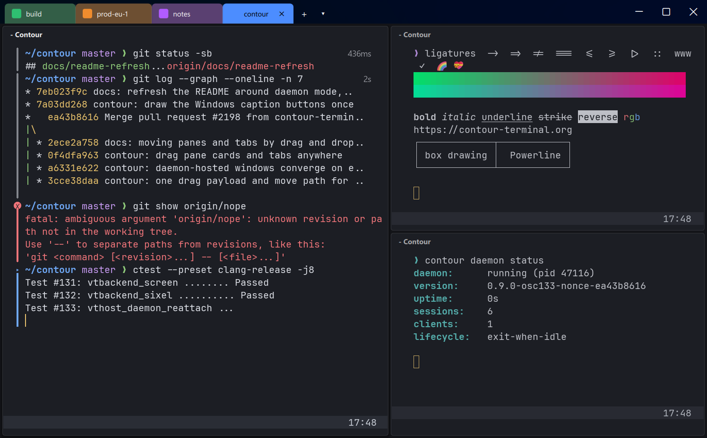

# Contour - a modern & actually fast Terminal Emulator
[](https://github.com/contour-terminal/contour/actions/workflows/build.yml)
[](https://codecov.io/gh/contour-terminal/contour)
[](https://isocpp.org/)
[](https://discord.gg/ncv4pG9)
[](https://twitch.tv/christianparpart)


<p align="center">
  <picture>
    <source media="(prefers-color-scheme: dark)" srcset="docs/screenshots/contour-main-dark.png">
    <source media="(prefers-color-scheme: light)" srcset="docs/screenshots/contour-main-light.png">
    
  </picture>
</p>

`contour` is a modern and actually fast, modal, virtual terminal emulator
for everyday use. It is aimed at power users with a modern feature mindset, and
it feels native on Windows 11, macOS and Linux.

## Highlights

- 🔌 **Sessions that outlive the window.** A background [daemon](https://contour-terminal.org/persistent-sessions/)
  hosts your shells by default: close the window, lose the SSH link or reboot, and pick up where you left off — locally, over SSH or over TLS.
- 🪟 **Tabs, splits and drag-and-drop.** [Drag a pane or a tab anywhere](https://contour-terminal.org/demo/drag-and-drop/):
  beside another pane, into another tab, into another window — the session inside keeps running.
- 🎨 **Colored tabs** — per [layout](https://contour-terminal.org/configuration/layouts/), per profile (`tab_color`), or from the tab's context menu —
  with badges for unseen output, finished commands and programs that are waiting for you.
- 🧱 **Command blocks.** An exit-status rail, folding, line numbers and timestamps, a sticky command header, step-through
  keys, and a notification when a long command finishes in a tab you are not looking at ([demo](https://contour-terminal.org/demo/command-blocks/)).
- 🖥️ **Native chrome, light and dark.** Mica and Snap Layouts on Windows 11, native menus on macOS, a header bar on Linux —
  or a character-cell *Terminal* style — all following your OS theme, with a Settings window and a command palette.
- ⚡ **Fast.** GPU-accelerated rendering, synchronized output, and a PTY-to-grid pipeline that is measured for key-press latency under load.
- 🔤 **Text done right.** Font ligatures, full Unicode with grapheme clusters, emoji (ZWJ, VS15, VS16), bold and italic, High-DPI.
- 🖼️ **Graphics.** Sixel, the kitty graphics protocol (including animation) and ReGIS vector graphics.
- 🎯 **Keyboard-driven.** Vi-like input modes, [hint mode](https://contour-terminal.org/demo/hint-mode/) for URLs, paths and git hashes,
  clickable links in any output, a GUI find bar and a quick-terminal hotkey.
- 🤖 **Scriptable.** A [control API and CLI](https://contour-terminal.org/control-api/) to list, split, type into and read panes and command blocks,
  sandboxed WebAssembly [status-line extensions](https://contour-terminal.org/extensions/), and a tmux control-mode gateway in both directions.

## Features

**Windows, tabs and sessions**

- ✅ Available on all major platforms: Linux, macOS, FreeBSD, OpenBSD and Windows.
- ✅ [Persistent sessions](https://contour-terminal.org/persistent-sessions/) (daemon mode) — reattach locally or over the network, restore your workspace after a reboot, and interoperate with tmux in both directions
- ✅ Terminal tabs and split panes, with colored tabs, tab badges and drag-and-drop rearranging of panes and tabs
- ✅ [Layouts](https://contour-terminal.org/configuration/layouts/): named sets of tabs and panes, opened with one action
- ✅ Saved remote hosts and a Connect picker that asks where a window's sessions should live
- ✅ Quick terminal: a global hotkey slides a terminal down from the top of the screen
- ✅ Profiles (grouped customization of: color scheme, login shell, and related behaviors)

**Reading and navigating output**

- ✅ Command blocks, with shell integration for bash, zsh, fish, tcsh and PowerShell
- ✅ Vertical Line Markers (quickly jump to markers in your history!)
- ✅ Vi-like input modes for improved selection and copy'n'paste experience and Vi-like `scrolloff` feature.
- ✅ Hint mode, and URLs, file paths and custom patterns made clickable in whatever a program prints
- ✅ Clickable hyperlinks via [OSC 8](https://gist.github.com/egmontkob/eb114294efbcd5adb1944c9f3cb5feda)
- ✅ Read-only mode, protecting against accidental user-input to the running application, such as <kbd>Ctrl</kbd>+<kbd>C</kbd>.
- ✅ VT320 Host-programmable and Indicator status line support, extensible with sandboxed WebAssembly.

**Rendering and text**

- ✅ GPU-accelerated rendering.
- ✅ Font ligatures support (such as in Fira Code and JetBrains Mono).
- ✅ Unicode: Emoji support (-: 🌈 💝 😛 👪 - including ZWJ, VS15, VS16 emoji :-) and grapheme clusters
- ✅ Bold and italic fonts, High-DPI support.
- ✅ 256-color and Truecolor support
- ✅ Blurred behind transparent background support for Windows 10 and above as well as the KDE and GNOME desktop environment on Linux.
- ✅ Blurrable Background image support.
- ✅ Builtin [Fira Code inspired progress bar](https://github.com/contour-terminal/contour/issues/521) support, also shown in the taskbar and Dock.

**Protocols**

- ✅ [Synchronized rendering](https://contour-terminal.org/vt-extensions/synchronized-output/) (via `SM ? 2026` / `RM ? 2026`)
- ✅ Text reflow (configurable via `SM ? 2028` / `RM ? 2028`)
- ✅ Sixel inline images, the kitty graphics protocol and ReGIS vector graphics (VT330/VT340)
- ✅ Clipboard setting via OSC 52
- ✅ Terminal page [buffer capture VT extension](https://contour-terminal.org/vt-extensions/buffer-capture/) to quickly extract contents.

**Customization**

- ✅ A Settings window with a live preview, and runtime configuration reload
- ✅ Color Schemes, including built-in `contour-dark` and `contour-light`, and key binding customization
- ✅ Native, Terminal and classic UI styles

and much more — see the [full feature list](https://contour-terminal.org/features/).

## Installation

`contour` is packaged and available for installation on multiple distributions:
 - `Fedora` use official [package](https://packages.fedoraproject.org/pkgs/contour-terminal/contour-terminal/)
 - `Arch` use official [package](https://archlinux.org/packages/extra/x86_64/contour/)
 - `Void` use official [package](https://github.com/void-linux/void-packages/tree/master/srcpkgs/contour)
 - `openSUSE` use official [package](https://build.opensuse.org/package/show/X11:terminals/contour-terminal)

Additional packages can be found on the release [page](https://github.com/contour-terminal/contour/releases) including:
 - ubuntu package
 - AppImage
 - static build
 - MacOS bundle
 - Windows installer and zipped app


### Installing via Flatpak

#### Install from Flathub

Click the following button to install Contour from the Flathub store.

[](https://flathub.org/apps/details/org.contourterminal.Contour)


#### Prerequisites

- Make sure you have flatpak installed in your system ([here is a tutorial on how to install it](https://flatpak.org/getting.html)), and make sure that the version is >= 0.10 (check it using this command: `flatpak --version`)
- Add the [flathub](https://flathub.org) repository using the following command: `flatpak remote-add --if-not-exists flathub https://dl.flathub.org/repo/flathub.flatpakrepo`.
- Proceed with one of the following options:
  - [Install from Flathub](#install-from-flathub)
  - [Install from GitHub release](https://github.com/contour-terminal/contour/releases)

## Requirements

- **operating system**: A *recent* operating system (macOS, Windows 10+, an up-to-date Linux, FreeBSD or OpenBSD)
- **GPU**: driver must support at least OpenGL 3.3 hardware accelerated or as software rasterizer.
- **CPU**: x86-64 AMD or Intel with AES-NI instruction set or ARMv8 with crypto extensions.

## Configuration

Most settings live in the **Settings** window (<kbd>Ctrl</kbd>+<kbd>Shift</kbd>+<kbd>,</kbd>,
<kbd>⌘</kbd>+<kbd>,</kbd> on macOS), which applies every change at once and previews it live.
Everything it edits is the configuration file `contour.yml`, which is initially generated in
`$HOME/.config/contour` (`%LOCALAPPDATA%\contour` on Windows) and can be edited by hand.
Some features also require shell integration. It can be installed from Settings, or generated
via the CLI (see below) for bash, zsh, fish, tcsh and PowerShell (`pwsh`); Nushell integrates natively.

## Persistent sessions (daemon mode)

Contour hosts your sessions in a background daemon by default (`daemon.mode: auto`): a plain
`contour` starts one when none runs and shows its sessions in a thin client window. Close the
window and your shells keep going. A long build finishes, work done over SSH survives the link
dropping, and a rebooted machine restores its windows, tabs, splits and scrollback. The same
sessions can be reattached from another machine over SSH or an encrypted TLS connection.

```sh
contour                       # a window onto the daemon's sessions, starting it if need be
contour --daemon-mode in_process   # keep this window's sessions in the window itself
contour connect               # pick where a window's sessions live: this computer, a saved host, ssh://, tls://
contour daemon status         # version, uptime, sessions and clients of the running daemon
```

The daemon runs as a managed user service (systemd, launchd or Task Scheduler), survives an
upgrade, and negotiates its protocol version with each client, so releases can be mixed. If it
cannot be reached, Contour falls back to running the window's shells itself and says so.

Contour also speaks tmux's control-mode protocol in both directions: tmux-aware tooling — and the
stock `tmux` binary itself — can attach to a Contour daemon, and `contour client --tmux` mirrors a
running tmux server into a Contour window, windows as tabs and panes as splits.

Every window, tab and pane has a stable ID, and the daemon serves a typed
[control API](https://contour-terminal.org/control-api/) that `contour ls`, `new`, `split`, `send`,
`pane capture` and `block read` script from the shell — handy for tooling and coding agents alike.

See [Persistent sessions](https://contour-terminal.org/persistent-sessions/) for the full guide.

## Installing from source

Contour is best installed from supported package managers, but you can build
from source by following the instructions below.

### UNIX-like systems (Linux, FreeBSD, OpenBSD, macOS)

#### Prerequisites

```sh
./scripts/install-deps.sh
```

This script *might* ask you for the administrator password if a package dependency
can be installed via the system package manager.

#### Compile

You can use cmake presets to compile contour. The full list of available presets can be seen using `cmake --list-presets`. To compile release build for linux `clang-release` or `gcc-release`, or `appleclang-release` on macOS accordingly.

```sh
cmake --preset clang-release
cmake --build --preset clang-release

# Optionally, if you want to install from source
cmake --build --preset clang-release --target install
```

#### Windows 10 or newer

#### Prerequisites

For Windows, you must have Windows 10, 2018 Fall Creators Update, and Visual Studio 2019, installed.
It will neither build nor run on any prior Windows OS, due to libterminal making use of [ConPTY API](https://devblogs.microsoft.com/commandline/windows-command-line-introducing-the-windows-pseudo-console-conpty/).

### Using External ConPTY Support on Windows 10

On Windows 10, the built-in ConPTY implementation has limitations with mouse input handling, particularly when using WSL2 with terminal applications like tmux. This is a known issue that affects several terminal emulators.

Contour supports using an external `conpty.dll` implementation which resolves these issues on Windows 10.

To enable external ConPTY:

1. Get `conpty.dll` and `OpenConsole.exe` files from wezterm:
   Go to https://github.com/wez/wezterm/tree/main/assets/windows/conhost and download `conpty.dll` and `OpenConsole.exe`
2. Put these files into your Contour bin directory (e.g. C:\Program Files\Contour Terminal Emulator 0.6\bin\)
3. Start Contour. It will automatically detect and use the external ConPTY implementation.

1. Set up [vcpkg](https://vcpkg.io/en/getting-started.html), preferably somewhere high up in the folder hierarchy, and add the folder to your `PATH`.

```
cd C:\
git clone https://github.com/Microsoft/vcpkg.git
.\vcpkg\bootstrap-vcpkg.bat
```

2. Install Visual Studio Build Tools (make sure to select the CLI tools for
   C++, which you might need to do in the separate components tab).
3. Install Qt6 (i.e. to C:\Qt)
4. Open the _developer_ version of Powershell.
5. In the `contour` source folder execute `.\scripts\install-deps.ps1`. This step may take a _very_ long time.


#### Compile

In the _developer_ version of Powershell:

```psh
# change paths accordingly if you installed QT and vcpkg to somewhere else
cmake -S . -B build -DCMAKE_TOOLCHAIN_FILE=C:\vcpkg\scripts\buildsystems\vcpkg.cmake -DCMAKE_PREFIX_PATH=C:\Qt\6.5.0\msvc2019_64\lib\cmake
cmake --build build/

# Optionally, if you want to install from source
cmake --build build/ --target install
```

#### Distribution Packages

[](https://repology.org/project/contour-terminal/versions)

## CLI - Command Line Interface

`contour help` prints every command with its options. The main ones:

```txt
  Usage:

    contour [terminal] [config FILE] [profile NAME] [layout NAME] [daemon-mode MODE]
                       [working-directory DIRECTORY] [class WM_CLASS] [PROGRAM ARGS...]
    contour connect [TARGET]            Where a window's sessions live: daemon, local, a saved host, ssh:// or tls://
    contour client [socket PATH] [label NAME] [host NAME|URL] [tmux]
    contour daemon [socket PATH] [label NAME] [listen-tcp HOST:PORT] [tls-cert FILE] [tls-key FILE]
                   status | logs | stop
    contour daemon-service install|uninstall|start|stop|restart|status [label NAME]
    contour ls | new | split | send | pane capture | close | label    Script the daemon's windows, tabs and panes
    contour block list | read   and   contour wait | events          Read command blocks and follow what happens
    contour api list | describe | call                               The typed control API
    contour agent setup                                              Teach coding agents to operate Contour panes
    contour cat [IMAGE_FILE]                                         Show an image in the terminal
    contour capture [logical] [words] [lines COUNT] to FILE          Capture the screen contents
    contour set profile [to NAME]
    contour generate config|terminfo|integration shell SHELL to FILE
    contour info vt | info config | documentation vt|keys|configuration global|profile
    contour help | version | license | list-debug-tags | font-locator
```

# References

* [VT510](https://vt100.net/docs/vt510-rm/): VT510 Manual, see Chapter 5.
* [ECMA-35](http://www.ecma-international.org/publications-and-standards/standards/ecma-35):
    Character Code Structure and Extension Techniques
* [ECMA-43](http://www.ecma-international.org/publications-and-standards/standards/ecma-43):
    8-bit Coded Character Set Structure and Rules
* [ECMA-48](http://www.ecma-international.org/publications-and-standards/standards/ecma-48):
    Control Functions for Coded Character Sets
* [ISO/IEC 8613-6](https://www.iso.org/standard/22943.html):
    Character content architectures
* [xterm](https://invisible-island.net/xterm/ctlseqs/ctlseqs.html): xterm control sequences
* [console\_codes](http://man.he.net/man4/console_codes) Linux console codes
* [Summary of ANSI standards for ASCII terminals](http://www.inwap.com/pdp10/ansicode.txt)
* [Text Terminal HOWTO (Chapter 7.2, PTY)](http://tldp.org/HOWTO/Text-Terminal-HOWTO-7.html#ss7.2)
* [ANSI escape code](https://en.wikipedia.org/wiki/ANSI_escape_code) in Wikipedia

### License

```
Contour - A modern C++ Terminal Emulator
-------------------------------------------

Licensed under the Apache License, Version 2.0 (the "License");
you may not use this file except in compliance with the License.

Unless required by applicable law or agreed to in writing, software
distributed under the License is distributed on an "AS IS" BASIS,
WITHOUT WARRANTIES OR CONDITIONS OF ANY KIND, either express or implied.
See the License for the specific language governing permissions and
limitations under the License.
```
