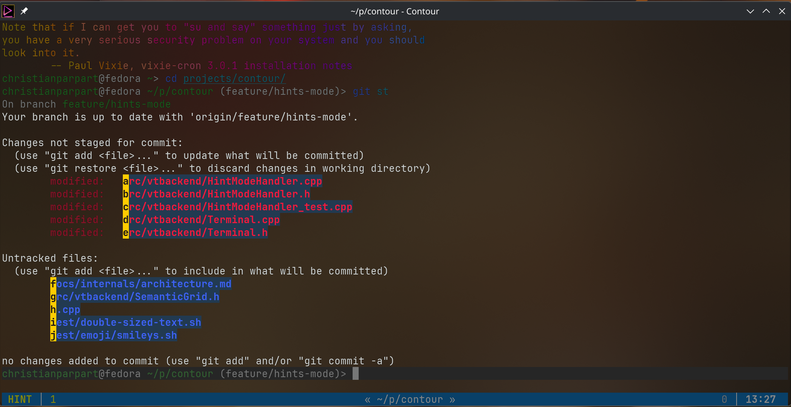
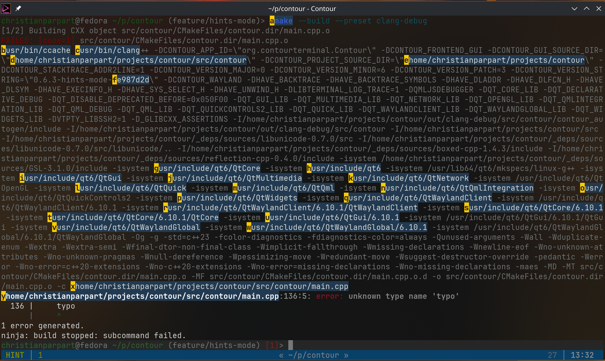

# Hint Mode

Hint mode lets you quickly act on clickable elements visible in the terminal —
URLs, file paths, git commit hashes, IP addresses — using only the keyboard.
When activated, Contour scans the visible screen for recognized patterns,
overlays a short alphabetic label on each match, and waits for you to type a
label to perform an action on that match.

Think of it like [Vimium](https://vimium.github.io/) for your terminal.



## Activating Hint Mode

There are two ways to enter hint mode:

### Via Key Binding (from any mode)

The default key binding activates hint mode for URLs:

```yaml
input_mapping:
    - { mods: [Control, Shift], key: U, action: HintMode, patterns: url, hint_action: Open }
```

Press <kbd>Ctrl</kbd>+<kbd>Shift</kbd>+<kbd>U</kbd> to scan for URLs
and open the selected one in your browser.

### Via Vi Normal Mode

When in [normal mode](../input-modes.md), you can use:

- `gh` — activate hint mode with **Copy** action (yank the match to clipboard)
- `gH` — activate hint mode with **Open** action (open the match, e.g. URL in browser)

These commands scan with the profile's patterns: the builtins (URLs, file paths,
git hashes, IPs) and your own `hint_patterns`.

## Using Hint Mode

Once hint mode is active:

1. **Labels appear** — Each detected match gets a short label (`a`, `b`, ..., `z`; or two-character labels `aa`, `ab`, ... for more than 26 matches).
2. **Type the label** — Type the label characters to select a match. Labels are case-insensitive.
3. **Auto-select** — As soon as your typed characters uniquely identify a match, the action is performed automatically.
4. **Cancel** — Press <kbd>Escape</kbd> to exit hint mode without selecting anything.
5. **Backspace** — Press <kbd>Backspace</kbd> to undo the last typed label character.

## Recognized Patterns

Contour ships with the following builtin pattern detectors:

| Pattern     | Examples                                     | Description                        |
|-------------|----------------------------------------------|------------------------------------|
| `url`       | `https://example.com`, `http://localhost:8080` | `http`, `https`, `ftp`, `file` and `mailto` URLs |
| `filepath`  | `/home/user/file.txt`, `./src/main.cpp`, `src/main.cpp:12:5`, `C:\Users\me\notes.txt`, `Makefile` | Absolute, relative, home-relative (`~/...`) and Windows paths, and bare file names; a `:line[:column]` or `(line[,column])` after one is kept as its location |
| `githash`   | `a1b2c3d`, `abc1234567890def1234567890abcdef12345678` | 7–40 character hex strings (git commit SHAs) |
| `ipv4`      | `192.168.1.1`, `10.0.0.1:8080`               | IPv4 addresses, optionally with port |
| `ipv6`      | `::1`, `fe80::1`, `2001:0db8:85a3:0000:0000:8a2e:0370:7334` | IPv6 addresses |

### Smart File Path Detection

Hint mode and the links Contour underlines in output share one path grammar,
which takes bare names and a location printed after a path (`main.cpp:42:10`).
When the terminal knows the current working directory, or the directory a command
ran in (via [shell integration](../vt-extensions/osc-133-shell-integration.md)),
file path detection also matches:

- **Bare filenames with extensions** — `main.cpp`, `README.md`
- **Extensionless files** — `Makefile`, `LICENSE`, `Dockerfile`, `CHANGELOG`
- **Directory names** — `src`, `build`, `docs`

These bare names are validated against the filesystem: only entries that actually
exist in that directory are shown as hints. This means you can
look at `ls` output, compiler errors, or `git status` and jump directly to the
referenced files.



## Actions

The `hint_action` parameter controls what happens when you select a match:

| Action         | Description                                                  |
|----------------|--------------------------------------------------------------|
| `Copy`         | Copy the matched text to the system clipboard (default); a path, resolved to its absolute form |
| `Open`         | Open the match as Ctrl+click opens it — web URLs in the browser, directories in the file manager, and files (a `file://` URL among them) with [`file_opener`](../configuration/links.md#file_opener) at the line they were printed with |
| `Paste`        | Paste the matched text into the terminal input               |
| `CopyAndPaste` | Copy to clipboard **and** paste into the terminal            |
| `Select`       | Enter vi visual mode with the match range pre-selected for manual adjustment |

## Configuration

### Key Bindings

You can create multiple hint mode bindings for different pattern sets and actions:

```yaml
input_mapping:
    # Open URLs in browser
    - { mods: [Control, Shift], key: U, action: HintMode, patterns: url, hint_action: Open }

    # Copy file paths to clipboard
    - { mods: [Control, Shift], key: F, action: HintMode, patterns: filepath, hint_action: Copy }

    # Copy git hashes to clipboard
    - { mods: [Control, Shift], key: G, action: HintMode, patterns: githash, hint_action: Copy }

    # Scan for all patterns and copy
    - { mods: [Control, Shift], key: H, action: HintMode, patterns: all, hint_action: Copy }
```

The `patterns` parameter accepts:

- A single pattern name: `url`, `filepath`, `githash`, `ipv4`, `ipv6`
- Multiple pattern names separated by `|`: `filepath|githash`
- `all` or empty: scan for all builtin patterns at once

### Scope: Reaching Into Scrollback

By default hint mode scans only what is on screen. The `scope` parameter widens
that to the scrollback history:

```yaml
input_mapping:
    # Scan the visible page (the default — may be omitted)
    - { mods: [Control, Shift], key: U, action: HintMode, patterns: url, hint_action: Open, scope: Visible }

    # Scan the visible page *and* scrollback history
    - { mods: [Control, Shift], key: Y, action: HintMode, patterns: url, hint_action: Open, scope: Scrollback }
```

Under `scope: Scrollback`, labels are assigned once when hint mode is activated and
then **stay put**: scrolling reveals the labels on other rows rather than renaming
the ones you have already read. So the workflow is: activate, scroll to the output
you want, then type its label. A label acts on its match even while it is off screen.

`scope: Visible` behaves the other way round, because its scan region *is* the
viewport: scrolling re-scans and re-labels.

How much history a `Scrollback` activation reads is capped per profile, so a very
large scrollback does not turn one keystroke into a long scan:

```yaml
profiles:
  main:
    # Maximum scrollback rows a `scope: Scrollback` activation scans (default: 1000).
    hint_scrollback_lines: 1000
```

### Wrapped Lines

A pattern is matched against the *logical* line, so a URL that the terminal broke
across two or more rows because the window was too narrow is still found as a
single hint, and selecting it yields the whole URL rather than the fragment on one
row. The label sits at the start of the match, and the highlight follows the match
across the line break.

A hint is only offered where its label can be drawn. A match that begins above the
scanned region — so that its label would be invisible — is not offered, since a
label you cannot see is a label you cannot type. A match that begins inside the
region and runs past its end *is* offered, and still yields its complete text.

### Colors

Hint mode label and match colors are configured in the color scheme section of
your configuration:

```yaml
color_schemes:
    default:
        # Colors for the short alphabetic labels overlaid on matches.
        hint_label:
            foreground: '#000000'
            foreground_alpha: 1.0
            background: '#E5C07B'
            background_alpha: 1.0

        # Colors for the matched text behind the labels.
        hint_match:
            foreground: '#ABB2BF'
            foreground_alpha: 1.0
            background: '#3E4452'
            background_alpha: 0.8
```

### Custom Patterns

You can define your own hint patterns in the profile configuration. Each pattern
needs a `name` (used to reference it in key bindings) and a `regex`
([ECMAScript syntax](https://en.cppreference.com/w/cpp/regex/ecmascript)):

```yaml
profiles:
  main:
    hint_patterns:
      - name: uuid
        regex: '\b[0-9a-fA-F]{8}-[0-9a-fA-F]{4}-[0-9a-fA-F]{4}-[0-9a-fA-F]{4}-[0-9a-fA-F]{12}\b'
      - name: docker_id
        regex: '\b[0-9a-f]{12,64}\b'
```

Custom patterns with the same name as a builtin override the builtin definition.
You can then reference custom patterns in key bindings just like builtins:

```yaml
input_mapping:
    - { mods: [Control, Shift], key: I, action: HintMode, patterns: uuid, hint_action: Copy }
```

Back-references (`\1` to `\9`) are not supported; a pattern using one is reported
when the configuration is loaded and disabled.

### Clickable Patterns

[Links in Terminal Output](../configuration/links.md) describes the links Contour
finds in output, and how they open, in full.

A pattern can also be found in the terminal's output without entering hint mode:
with `clickable: true` its matches are decorated as links are (see
`hyperlink_decoration`) and opened with Ctrl+click. `url` says what is opened,
with `{0}` standing for the whole match and `{1}` to `{9}` for its capture
groups. Without `url`, the match is opened as printed.

Where the printed text chooses the scheme (no `url`, or a `url` that does not
start with a scheme of its own, such as `{0}`), a match opens only with a scheme
Contour opens in URLs it finds itself: `http`, `https`, `ftp`, `mailto` or
`file`. Any other is no link: it is not underlined, and hint mode offers it to
copy and opens nothing. A `url` that writes its scheme itself may open any.

Only what a URL cannot hold is percent-encoded as a group is put in: spaces,
control characters and `` "#<>[\]^`{|} ``. Characters such as `/ ? & = + @ : %`
pass through, so a group placed in a query can add parameters, and one placed
before the host can change it. Write the scheme and the host in the template
itself, as the examples below do, and put groups after them.

```yaml
profiles:
  main:
    hint_patterns:
      - name: jira
        regex: '\b[A-Z][A-Z0-9]+-\d+\b'
        clickable: true
        url: 'https://jira.example.com/browse/{0}'
      - name: github_issue
        regex: '\b([\w.-]+)/([\w.-]+)#(\d+)\b'
        clickable: true
        url: 'https://github.com/{1}/{2}/issues/{3}'
      - name: commit
        regex: '\b[0-9a-f]{7,40}\b'
        clickable: true
        url: 'https://github.com/contour-terminal/contour/commit/{0}'
```

The builtins `url` and `filepath` are clickable, and `githash`, `ipv4` and `ipv6`
are offered in hint mode only. An entry named like a builtin changes only the keys
it gives, so it may leave out its `regex`:

```yaml
    hint_patterns:
      - name: filepath
        clickable: false   # stop underlining paths; hint mode still offers them
```

A `url` template applies to your own patterns only: a builtin opens what it finds,
and a `url` given to one is reported and ignored. So `clickable: true` on
`githash`, `ipv4` or `ipv6` alone makes no link, as a bare hash or address names
no scheme; to link commits to their page, write a pattern of your own with a
`url`, as `commit` above does.

A `url` that names a capture group the regex does not have, such as `{2}` for a
regex with one group, is reported when the configuration is loaded and disables
the pattern.

A regex that overrides `filepath` must say which part of its match is the path:
capture group 1 is the path, groups 2 and 3 a `:line[:column]` printed after it,
and groups 4 and 5 a `(line[,column])`. An override of `filepath` without a
capture group is reported and disabled. Every other pattern's link is its whole
match, `{0}`.

### Path Resolution

When copying or opening file paths, Contour resolves relative paths to absolute
using the directory the command that printed them ran in, as shell integration
recorded it, so a `cd` since then does not change what an earlier command's output
names. Outside any command's output, the terminal's current working directory is
used. For example, copying a hint for `src/main.cpp` gives you
`/home/user/project/src/main.cpp` in the clipboard, and opening it passes the full
path to your editor or file manager. Ctrl+clicking a path resolves it the same way.

A command that changes directory itself, such as `cd build && make`, prints paths
relative to where it went. The shell reports that directory only at the next
prompt, so a path not found where the command started is looked up there too.

Paths printed by a command that ran on another machine (over ssh, in a container)
name files there, so they are neither offered as hints nor opened here. That
includes the output of an `ssh` session whose remote shell reports its directory
but marks no commands of its own: everything it printed belongs to the local `ssh`
command, and stays refused after you return to the local prompt.

Home-relative paths (`~/...`) are expanded using the `HOME` environment variable.

## Tips and Tricks

- **Shell integration matters** — Ensure your shell reports the current working
  directory via [OSC 133](../vt-extensions/osc-133-shell-integration.md) for the
  best file path detection. Without it, only paths containing a `/` separator are
  matched.

- **Combine with Vi mode** — In normal mode, `gh` (copy) and `gH` (open) are
  quick ways to enter hint mode without reaching for modifier keys.

- **Works with scrollback** — Hint mode scans the currently visible viewport.
  Scroll to the area of interest first, then activate hint mode.

- **Compiler errors** — When viewing build output with file paths like
  `src/main.cpp:42:10: error: ...`, hint mode detects the file path portion,
  making it easy to copy or open the referenced file.

## Related

- [Input Modes](../input-modes.md) — Vi-like input modes including normal mode, where `gh`/`gH` trigger hint mode
- [Key Mapping](../configuration/key-mapping.md) — How to customize key bindings
- [Shell Integration](../vt-extensions/osc-133-shell-integration.md) — Enables smart bare filename detection
