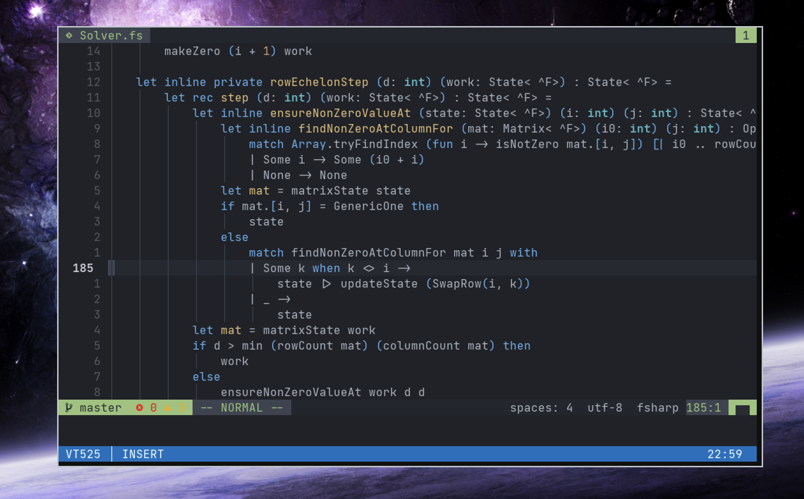
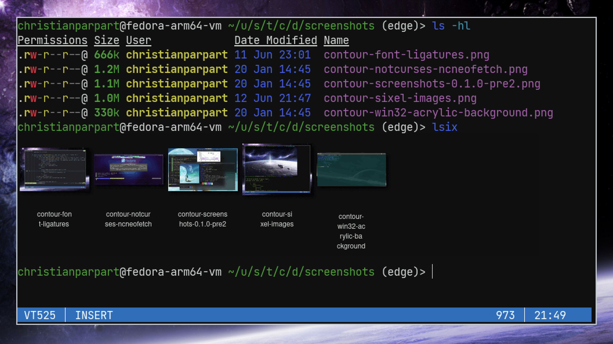
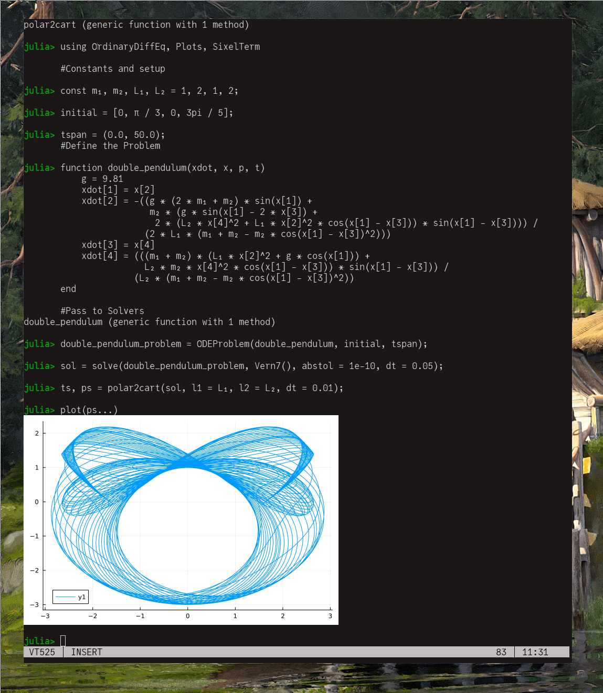

# Features

Everything Contour does, grouped by what you do with it. A card with a link opens its guide.

## Window and sessions

- [**Persistent sessions** Daemon mode: sessions survive the window, reattach locally or over the network, and interoperate with tmux in both directions.](persistent-sessions.md)
- [**Workspace sidebar** Workspaces, tabs and panes as a tree, across every daemon you use.](sidebar.md)
- [**Remote hosts** Attach to sessions on another machine.](remote-hosts.md)
- [**Quick terminal** A global hotkey slides a terminal down from the top of the screen.](quick-terminal.md)
- [**Tabs and split panes** Colored tabs, tab badges and drag-and-drop rearranging of panes and tabs.](configuration/layouts.md#tab-colors)
- [**Layouts** Named sets of tabs and panes that open together.](configuration/layouts.md)
- [**Drag and drop** Drop a tab on a pane edge to split it, or files to type their escaped paths.](demo/drag-and-drop.md)
- **Native window chrome** Windows 11, macOS and Linux, in light and dark, with a Settings window, a command palette and a character-cell Terminal style.
- **Cross-platform** Linux, macOS, FreeBSD, OpenBSD and Windows.
- **GPU-accelerated and high-DPI** GPU-accelerated rendering with high-DPI support.
- **Find bar** A live match count, floating over the pane being searched.
- **Runtime configuration reload** Change the configuration and see it without a restart.
- **Key binding customization**
- **Color schemes and profiles** A profile groups a color scheme, a login shell and related behaviors.
- **Transparent background** Blurred behind the window on Windows 10 and on KDE; a blurrable background image is supported too.
- **Read-only mode** Protects the running application from accidental input, such as <kbd>Ctrl</kbd>+<kbd>C</kbd>.

## Text and graphics

- [**Font ligatures** Rendered out of the box, when your font has them.](#font-ligatures)
- **Unicode** Colored emoji, including ZWJ, VS15 and VS16 sequences, and grapheme clusters: 🌈 💝 😛 👪
- **Bold and italic fonts**
- **Nerd Font glyphs** Powerline, Font Awesome, Material Design, Devicons and more, with whichever font you choose: a symbols font is bundled.
- **256-color and Truecolor**
- [**Images** Sixel, kitty graphics and ReGIS vector graphics.](#images)
- [**Input method editor** Emoji and pinyin input through ibus.](#input-method-editor)
- [**Size indicator** The terminal size appears while you resize the window.](#size-indicator)
- [**Status line** VT320 host-programmable and indicator status line.](configuration/indicator-statusline.md#host-programmable-status-line)
- **Text reflow** Lines re-wrap when the window resizes; configurable via `SM ? 2028` / `RM ? 2028`.
- [**Synchronized rendering** `SM ? 2026` / `RM ? 2026`.](vt-extensions/synchronized-output.md)
- **Progress bar** A built-in [Fira Code inspired progress bar](https://github.com/contour-terminal/contour/issues/521).
- **Clickable links** URLs, file paths and your own patterns in whatever a program prints, opened with <kbd>Ctrl</kbd>+click; hyperlinks via [OSC 8](https://gist.github.com/egmontkob/eb114294efbcd5adb1944c9f3cb5feda). See [links](configuration/links.md).
- [**Clipboard** Set the clipboard and primary selection via OSC 52, advertised as the Clipboard Extension (`DA1` `52`).](https://github.com/contour-terminal/vt-extensions/blob/master/clipboard-extension.md)

## Working in the scrollback

- [**Command blocks** Exit-status gutter, line numbers, per-line timestamps, folding, scrollbar marks and a sticky command header.](demo/command-blocks.md)
- [**Restored sessions** History comes back above a "Restored" divider, with one toast saying what was restored.](demo/command-blocks.md#restored-sessions)
- [**Finish notifications** Know when a long-running command finishes in a tab you are not looking at.](demo/command-blocks.md#finish-notifications)
- [**Shell integration** For bash, zsh, fish, tcsh and PowerShell; Contour offers to install it for bash, zsh and fish, showing the one line it adds, also in Settings.](vt-extensions/osc-133-shell-integration.md)
- [**Vi-like input modes** Navigation, selection, copy and paste from the keyboard.](input-modes.md)
- [**Hint mode** Keyboard-driven selection of URLs, file paths, git hashes and more.](demo/hint-mode.md)
- [**Line marks** Vertical markers: jump quickly between marks in your history.](input-modes.md#line-marks)
- [**Buffer capture** A VT extension to quickly extract the terminal page's contents.](vt-extensions/buffer-capture.md)

## Automation

- [**Control API** `contour ls`, `new`, `split`, `send`, `pane capture` and `block` script the daemon's workspaces, tabs, panes and command blocks.](control-api.md)
- [**MCP server** `contour mcp` lets coding agents such as Claude Code and Codex split panes, run commands and read their output in their own tab.](control-api.md)
- [**Status-line extensions** Sandboxed WebAssembly extensions that draw in the status line.](extensions.md)

## Font ligatures

Contour renders your font ligatures out of the box.
If your font supports them, Contour will render them.

{ .shot }

## Images

Contour implements first-class [Sixel](https://en.wikipedia.org/wiki/Sixel) image support, as well as the kitty graphics protocol and [ReGIS vector graphics](demo/regis-graphics.md).
The kitty graphics protocol includes [Unicode placeholders and file media](vt-extensions/kitty-graphics.md),
which is what Claude Code draws its pictures, such as Mermaid diagrams, with.

Most notably supporting libraries,
are [notcurses](https://github.com/dankamongmen/notcurses/)
and [libsixel](https://github.com/libsixel/libsixel/).

Also, libsixel does provide a CLI to convert well known image formats (like PNG)
to Sixel format and have them printed to the terminal.

{ .shot }
{ .shot }

## Input method editor

An input method (or input method editor, commonly abbreviated IME) is an operating system component or program that enables users to generate characters not natively available on their input devices by using sequences of characters (or mouse operations) that are available to them. Using an input method is usually necessary for languages that have more graphemes than there are keys on the keyboard. More info can be found on [wikipedia](https://en.wikipedia.org/wiki/Input_method) and with more info how to setup it and use here [wiki.archlinux](https://wiki.archlinux.org/title/Input_method)

### Example of emoji input using ibus

List of emoji from [unicode](http://unicode.org/emoji/charts/full-emoji-list.html)

You can insert any unicode character using ibus IME by pressing Ctrl+Shift+u (default) and then insert unicode code for the emoji or other character.

### Example of input using pinyin via ibus

## Size indicator

On resize window with current terminal size will appear

