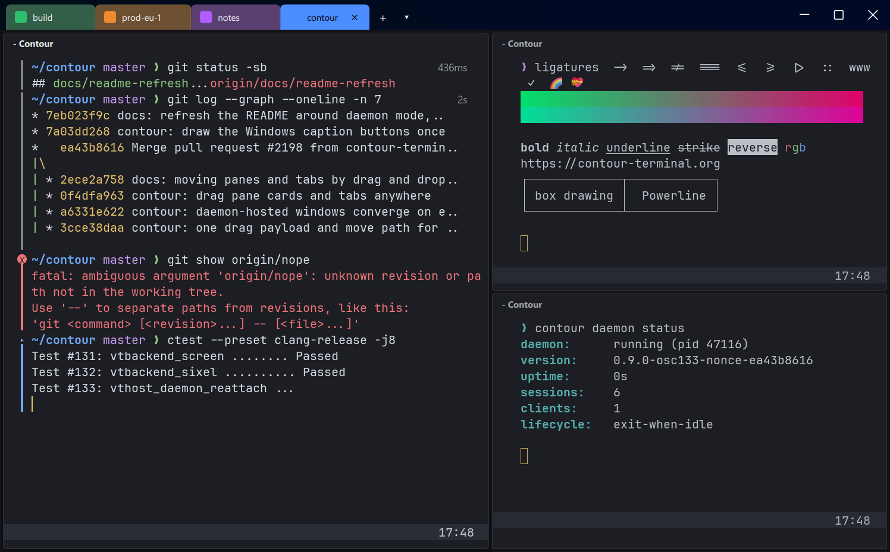

# Contour

A modern terminal emulator for everyday use: GPU-accelerated, high-DPI, Unicode-correct, with sessions that outlive the window.

[install](install.md){ .btn .fill }
[features](features.md){ .btn }
[github ↗](https://github.com/contour-terminal/contour){ .btn }
[discord ↗](https://discord.gg/ncv4pG9){ .btn }
{ .cta }

{ .shot .banner }

## Highlights

- [**Persistent sessions** A daemon keeps your shells alive. Detach and reattach, locally or over the network.](persistent-sessions.md)
- [**Command blocks** Fold output, see the exit status in the gutter, keep the command pinned while you scroll.](demo/command-blocks.md)
- [**Vi-like modes** Navigate, select and copy the scrollback without leaving the keyboard.](input-modes.md)
- [**Workspaces, tabs, panes** A sidebar that also tells you which program is waiting for you, on any daemon.](sidebar.md)
- [**Images and ligatures** Sixel, kitty graphics and ReGIS; font ligatures, emoji and grapheme clusters.](features.md#text-and-graphics)
- [**Scriptable** A control API, CLI verbs and an MCP server for coding agents.](control-api.md)

## Runs on

Linux · macOS · Windows · FreeBSD · OpenBSD
